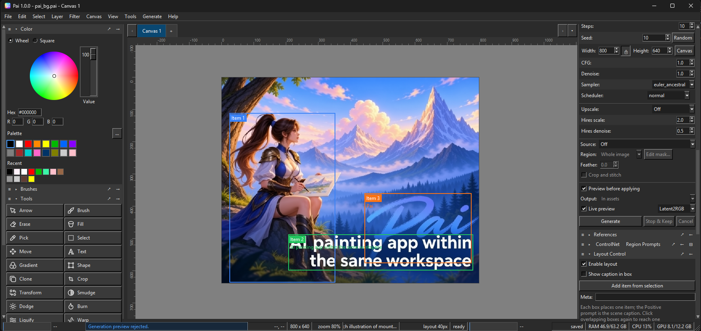

# Pai

[](https://github.com/g45t345rt/paiapp/actions/workflows/release.yml)
[](https://github.com/g45t345rt/paiapp/releases)
[](LICENSE)

A desktop painting and image-editing app with a built-in AI image generator. It has a layered canvas, brushes, selections, text, vector tools and poses, plus generation, upscaling and background removal that run locally.

Built with Python and Tkinter.



## Requirements

- Python 3.12–3.14 on your PATH
- Optional NVIDIA or AMD GPU for the AI features (CPU works too)

## Run

On Windows:

```
run.bat
```

On Linux/macOS (or Git Bash/WSL):

```
sh run.sh
```

The first run creates a private `.venv` next to the app and installs the dependencies; later runs reuse it. No other Python environment is needed.

## Launcher options

```
run.bat [--core-only] [--reinstall] [--setup-only] [--rocm] [--] [app args]
```

- `--core-only` – install the paint UI only, skip the AI engine
- `--reinstall` – rebuild the environment from scratch
- `--setup-only` – set up the environment, then exit
- `--rocm` – force the AMD ROCm build instead of auto-detecting

The compute backend is auto-detected on first run: an NVIDIA GPU installs the CUDA build, an AMD GPU installs the ROCm build, macOS uses the CPU build, and an unrecognised GPU falls back to CUDA (which also runs on CPU). Set `PAI_BACKEND` to `cuda`, `cpu` or `rocm` to override the detection.

On AMD, the specific GPU target for the ROCm wheel is also detected (from `rocminfo`, the Linux KFD topology, `rocm-bootstrap-detect` or `clinfo`); set `PAI_ROCM_GFX` (e.g. `PAI_ROCM_GFX=gfx1100`) to override it or narrow an `all`-kernels install.

Swapping GPU hardware (e.g. AMD to NVIDIA) is handled on the next launch: the changed backend is detected and the old torch build is uninstalled and replaced. `--reinstall` removes the whole `.venv` and rebuilds it from scratch.

## Project files

Projects are saved as `.pai` files: a zip archive with a small JSON manifest and one PNG per layer, so your work stays portable and easy to inspect.

## Contributing

See [CONTRIBUTING.md](CONTRIBUTING.md) for how to set up a development environment and run the tests.

## Community

Join the Discord server to ask questions, share your work and get help.

<a href='https://discord.gg/bU6RzjwxFX' target='_blank'></a>

## Support

Pai is free and open source. If you find it useful, you can support development with a donation on Ko-fi.

<a href='https://ko-fi.com/O5I829R7BD' target='_blank'></a>

## License

GPL-3.0. See [LICENSE](LICENSE) and [CREDITS.md](CREDITS.md).
